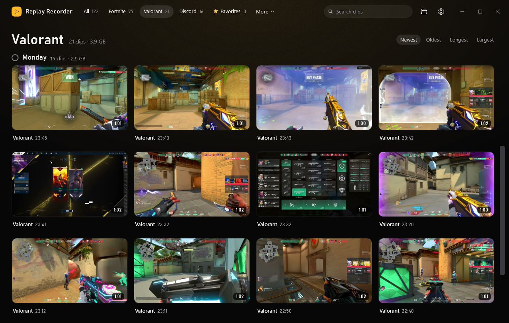
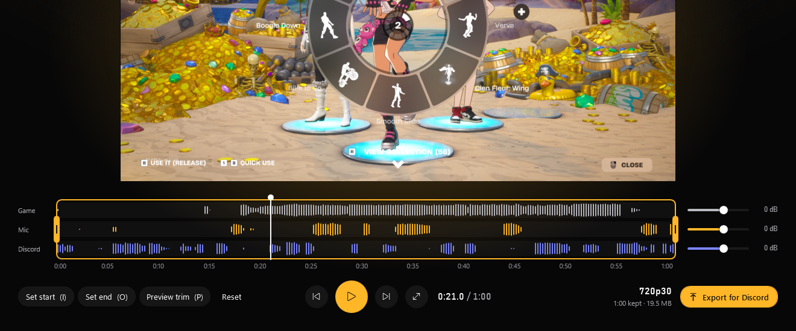

# Replay Recorder

A lightweight instant-replay recorder for Windows, an alternative to SteelSeries Moments and NVIDIA ShadowPlay. Press **Alt+.** to save the last 60 seconds. Clips keep your game, your mic and your Discord call on separate tracks, and you can export any clip for Discord in one click: it's guaranteed to fit under the upload limit.



## ⬇️ Download

**[Download Replay Recorder for Windows](https://github.com/3mirzenci/replay-recorder/releases/latest/download/ReplayRecorder-Setup.exe)**

To install:
1. Run the downloaded file.
2. Windows may say **"Windows protected your PC"**, because the app isn't code-signed (signing costs money every year). Click **More info**, then **Run anyway**.
3. Click through setup. It installs everything it needs, including ffmpeg and the mpv player.

You don't need a GitHub account. Updates arrive inside the app: when there's a new version, an **Update available** box shows up in the library and in the tray menu. One click installs it, and your clips and settings stay.

Two programs:

- **The recorder** (`ReplayRecorder.Recorder.exe`, tray icon) runs while you play. It keeps the last N seconds and saves a clip on a hotkey.
- **The library** (`ReplayRecorder.exe`) is a separate window for watching, trimming and exporting clips. Open it by double-clicking the tray icon. Closing it doesn't stop the recorder, and while it's closed it uses nothing.

Nothing is injected into games, so it's safe with anti-cheats like Vanguard and FACEIT. The app doesn't use accounts, telemetry or the cloud. The only network request it makes is checking this page for updates.

> **Still in development.** Replay Recorder is a pretty new app and gets better with each update. Clips are smooth in testing, but you may still run into the odd stutter or bug here and there. Updates arrive inside the app, so you get the fixes automatically.

## Features

### The library

- **Clips are grouped by day**, newest first. While you scroll, the current day's header stays at the top.
- **Click a clip to open it.** Hover over a thumbnail and move the mouse across it to preview the clip.
- **The ☆ in the corner** stars a clip. Click the **★ Favorites** pill at the top to see only starred clips.
- **Selecting:**
  - Click a clip's corner circle, or a day header to select that whole day. Ctrl+click and Shift+click also work.
  - While anything is selected, a click selects or unselects a clip instead of opening it.
  - The bar at the bottom can open, show in folder, copy files, export everything for Discord (each clip keeps its saved trim and volumes) or delete.
- **Right-click** gives the same actions, plus Rename (F2) and favorites.
- **Sound bars:** the timeline under a playing clip shows how loud the game, your mic and your Discord call were across the clip, one row each, so the action stands out. Each row has its own volume slider next to it. Drag the trim handles across them as usual.

  

- **Fullscreen:** the button next to the frame steps, or **F**, shows just the video with a see-through bar for play/pause, seeking and the game/mic volume. Esc or F comes back.
- **Large libraries stay light:** thumbnails are only loaded for clips on or near the screen. With 1000 clips the library opens in about 2 s and uses about 250 MB.
- **English and Turkish**, switchable live in Settings without a restart.

### Library shortcuts

| Key | Action |
|---|---|
| Space | Play / pause |
| ← / → | Previous / next frame |
| Shift+← / Shift+→ | Back / forward 5 s |
| J / L | Back / forward 10 s |
| I / O | Set trim start / end at the playhead |
| P | Preview the trimmed range on a loop |
| Home / End | Jump to trim start / end |
| F | Fullscreen on / off |
| E | Export for Discord |
| Del | Delete the clip for good (asks first) |
| Esc | Leave fullscreen, or back to the library |

### Export for Discord

In the player, click **Export for Discord** or press **E**. Replay Recorder encodes the trimmed range, with your game/mic balance, into an MP4 that is guaranteed to be under the target size (default 19.5 MB, set by `DiscordTargetMB`). Then:

- **drag the tile** into a Discord chat (a real Windows file drag), or
- click **Copy file** and press **Ctrl+V** in Discord, or
- click **Open folder**.

Exports are temporary, so they don't fill up your drive: they're kept in `%LOCALAPPDATA%\Replay Recorder\exports` and deleted 5 minutes after they're made (enough time for Discord to upload), whether the library is still open or not. The original clip is never changed. To keep exports, pick your own Discord exports folder in Settings; files there are never deleted.

How it fits the file under the limit:
- **Bitrate:** video bitrate = target bits ÷ duration − 128 kbps audio − 2% container overhead.
- **Resolution and fps:** it picks the best that bitrate can carry well: 1440p60 at 14 Mbps or more, 1080p60 at 6 or more, 720p60 at 3 or more, 720p30 at 1.5 or more, then 480p30 and 360p30. It never goes above the source.
- **Encoding:** NVENC with GPU decode and scaling, and two-pass libx264 if NVENC isn't available.
- **Size check:** the real file size is checked. If it's over, it re-encodes at a proportionally lower bitrate. A file only gets its final name once it's under the target.
- **Fast path:** if a plain cut of the original already fits and the volumes are untouched, it copies without re-encoding (instant, lossless, and starts on the nearest keyframe).

Measured on a 1440p60 clip with a 19.5 MB target:

| Length | Result | Size |
|---|---|---|
| 3 s | stream copy, 1440p60 | 10.4 MB |
| 10 s | 1440p60, 15.2 Mbps | 19.0 MB |
| 30 s | 720p60, 5.0 Mbps | 19.5 MB |
| 62 s | 720p30, 2.3 Mbps | 18.9 MB |
| 3 min | 480p30, 0.7 Mbps | 18.8 MB |
| 6 min | 360p30, 0.3 Mbps (2 passes) | 18.4 MB |

You can also drag the handles at both ends of the timeline. Trim and game/mic volume are saved per clip in `%LOCALAPPDATA%\Replay Recorder\cache\edits.json`. The original clip file is never changed.

## Performance

Replay Recorder 1.0.8 vs SteelSeries Moments, measured on one PC: a laptop with an RTX 4060 Laptop GPU and a 1440p 144 Hz screen, playing Call of Duty (Shipment). Five matches: one with no recorder, two with only Replay Recorder, two with only Moments, Discord closed. Clips saved per match: 14 and 14 with Replay Recorder, 13 and 24 with Moments (16 on average). Both apps record **1080p60** with a 60-second replay on their own default quality (Replay Recorder "Balanced", Moments "High"); the clips came out at a similar bitrate (29–37 vs 24–41 Mbps). 1080p is the one setting changed for a like-for-like comparison: Replay Recorder's default is your screen's resolution up to 1440p, which roughly doubles the encoder load (19 % instead of 10.6 % in the same game). Everything else is each app's default, including Replay Recorder's replay buffer on disk ("Keep the replay buffer in RAM" adds about 250 MB of RAM). The game's FPS was logged with [PresentMon](https://github.com/GameTechDev/PresentMon).

| | No recorder | Replay Recorder 1.0.8 | SteelSeries Moments + GG |
|---|---|---|---|
| Game FPS, average | 69 | **68 / 71** | 58 / 56 |
| Game FPS, 1 % low | 24 | **18 / 24** | 5 / 5 |
| Recorder CPU (share of the whole CPU) | – | 1.8 % | 2.4 % (1.7 % capture + 0.7 % GG app) |
| Recorder RAM | – | **~270 MB** | ~1 GB (~690 MB capture + ~315 MB GG app) |
| GPU video encoder | – | 10.6 % | 8.6 % |
| GPU | – | 4.1–4.6 % | 1.0 % |

The two numbers in a cell are the two matches. Matches vary by a few FPS on their own, so 71 with Replay Recorder vs 69 without doesn't mean recording made the game faster.

- **Game FPS:** with Replay Recorder the average was unchanged; the 1 % low matched the no-recorder match in one run and was lower in the other. With Moments, every save was followed a few seconds later by a lag spike in the game (37 out of 37 saves), and average FPS dropped by about 12, even in the match with only 13 saves. That many saves per match is more than most people make, so in everyday play Moments' penalty from its save spikes would be smaller.
- **RAM:** about a quarter of Moments'. Moments also starts a separate ffmpeg for each saved clip, on top of its total.
- **CPU and encoder:** about the same.
- **GPU:** Moments was lighter in 1.0.8. Since 1.0.10 Replay Recorder records through its own small capture ffmpeg (see [How recording works](#how-recording-works)), and GPU use in the same game dropped from 4.1–4.6 % to **under 1 %** (one match measured).
- **Smoothness:** in 1.0.10 about 90 % of a clip's frames are new pictures in a fast game, about the same as NVIDIA's own recorder (88 %). In 1.0.8 it was about half.

This is one game on one PC, so your numbers will differ. To measure on your own PC, see [Measuring resource use](#measuring-resource-use).

## How recording works

- Screen capture uses Windows Graphics Capture (or Desktop Duplication). The frames go straight into NVENC on the GPU. Nothing is injected into games, so it's safe with Vanguard and FACEIT.
- On NVIDIA cards, recording runs through `capture\ffmpeg-capture.exe`, a small ffmpeg that comes with the app. It takes the newest screen picture on a steady clock at your frame rate, like a camera, and converts it to the encoder's colour format itself, which keeps clips smooth and the GPU nearly idle. If it can't start on your PC, the app quietly switches to the normal ffmpeg until it restarts.
- The replay buffer is 2-second segments on disk. Old segments are deleted automatically. Saving joins them without re-encoding, which takes 1–2 s during a game; recording carries on meanwhile.
- **RAM buffer** (Settings → Instant replay): the segments are kept in memory instead, so nothing is written to the SSD until you save. It costs about 250 MB of RAM for a 60-second buffer. Full recordings still go to disk, because they can be long.
- **A short chime** plays when a clip is saved, and a lower one if saving failed, because the pop-up can't show over exclusive-fullscreen games. You can turn it off in Settings → General. The chime is quiet, but the recorder hears it, so it ends up faintly in the buffer after a save.
- Clips have four audio tracks:
  1. **Everything**: game, Discord and mic mixed together. Every normal player (Media Player, Discord, browsers) plays this one.
  2. **Game**: what you hear, without Discord.
  3. **Microphone**. **Mic leveling** (Settings → Audio) evens out quiet talk and shouting and cuts background noise between words. **Light** only tames shouting, **Medium** (default) keeps whispers quiet, **Strong** makes everything about as loud.
  4. **Discord**: your friends' voices (Discord, Discord PTB or Canary).

  Tracks 2–4 let the library rebalance game, mic and Discord later, each with its own slider and sound bar. The 4th track adds about 1 MB per minute.
- Discord gets its own track through Windows' *process loopback*, a normal Windows audio feature (Windows 10 2004 or later), so nothing touches Discord or the game. It records Discord's sound whichever output it plays on, so the output-device setting is only used while Discord isn't running. Discord starting late, restarting or updating is picked up within a few seconds. If you turn **Discord on its own track** off (Settings → Audio), or Windows refuses it, Discord stays in the game track as before and track 4 is silent.
- Clips from older versions have three tracks (track 2 is game + Discord) and keep working as before.
- Video and audio share one clock (Windows' performance counter), so a system-clock change doesn't put clips out of sync. Capture still restarts after the PC wakes from sleep.
- Virtual audio devices (HyperX NGENUITY, SteelSeries Sonar, VB-Cable) are detected automatically. Replay Recorder records the real headset behind them, so you get everything you hear, not just one virtual channel.
- Clips are saved as `Videos\Replay Recorder\<Game>\<Game> yyyy-MM-dd HH-mm-ss.mp4`.

## Install details

Setup needs no admin rights and installs to `%LOCALAPPDATA%\Programs\Replay Recorder`. It:
- installs ffmpeg and mpv with winget if they're missing;
- adds Start menu shortcuts, plus optional ones for a desktop icon and starting with Windows;
- starts the recorder when it finishes.

Uninstalling stops both apps and removes the autostart entry. Your clips and settings stay.

Requirements: Windows 10 2004 or later (needed for the separate Discord track), or Windows 11. An NVIDIA GPU for NVENC, with a driver from 2023 or newer (531+) for the smooth capture (Intel Quick Sync and x264 are fallbacks). ffmpeg 8.0 or newer (setup installs a current one): NVIDIA recording uses the bundled capture ffmpeg, and the normal one handles thumbnails, export, AMD/Intel recording and the fallback. The .NET runtime is bundled.

## Build from source

You need the .NET 10 SDK (`winget install Microsoft.DotNet.SDK.10`), ffmpeg (`winget install Gyan.FFmpeg`) and mpv (`winget install shinchiro.mpv`).

```
dotnet build ReplayRecorder.sln -c Release
build\Release\ReplayRecorder.Recorder.exe
```
Both apps build into `build\<Configuration>\`.

To build the installer you also need Inno Setup 6 (`winget install JRSoftware.InnoSetup`):

```
powershell -ExecutionPolicy Bypass -File build.ps1               # dist\ReplayRecorder-Setup.exe, ~59 MB
powershell -ExecutionPolicy Bypass -File build.ps1 -BundleTools  # offline installer with ffmpeg + mpv inside
```

`build.ps1` includes `ffmpeg-capture.exe` if `ffmpeg/build.sh` built it first (in MSYS2 UCRT64 with gcc, make, nasm and git; the GitHub release workflow does this). Without it the app records with the normal ffmpeg.

`ffmpeg-capture.exe` is FFmpeg 9.0.2 with [`ffmpeg/gfxcapture.patch`](ffmpeg/gfxcapture.patch), built with only LGPL parts. It's licensed under the LGPL 2.1 or later; its licence, the patch and a note on the source ship next to it in `capture\`.

The offline installer contains ffmpeg, which is GPL-licensed. If you share it, include ffmpeg's licence (the build copies it to `ffmpeg\LICENSE.txt`) and point to ffmpeg's source at https://ffmpeg.org.

### Releasing a new version

```
powershell -ExecutionPolicy Bypass -File release.ps1 -Notes "What changed"
```

This bumps the version in `Directory.Build.props` (1.0.3 becomes 1.0.4, or pass `-Version 1.1.0`), then commits, tags and pushes. GitHub builds the installer from the pushed code and creates the release (`.github/workflows/release.yml`, about 5 minutes), with your notes as its text; the "What's new" window shows them after the update. Every installed copy sees the update the next time it checks, at library start or every 6 hours in the tray.

The updater only downloads `ReplayRecorder-Setup.exe` from this repo's latest release, over HTTPS, from GitHub's own servers. The file must match the size and SHA-256 that GitHub lists for that file before it runs. Anyone who can publish releases here can ship code to every user, so keep two-factor authentication on the GitHub account.

## Using it

| Action | Default |
|---|---|
| Save the last 60 s | **Alt+.** |
| Start/stop a full recording | **Ctrl+Alt+F9** |
| Tray menu | right-click the icon (green = buffering, red = recording, grey = paused) |

From the command line, with the recorder already running:

- `ReplayRecorder.Recorder.exe --save`: save a clip (useful for Stream Deck or macros).
- `ReplayRecorder.Recorder.exe --toggle-record`: start or stop a full recording.
- `ReplayRecorder.Recorder.exe --diag-audio`: write a report on every audio device to `%LOCALAPPDATA%\Replay Recorder\logs\audio-diagnostics.txt`.

You can change the hotkeys in settings, e.g. `"SaveClipHotkey": "Ctrl+Shift+F10"`. A single punctuation key such as `.` `,` or `-` means the key that types that character on your current keyboard layout. Avoid Alt+F10 and Alt+F9, because the NVIDIA app overlay uses them. If a hotkey is taken, the tray shows a warning.

## Settings

Open them from the tray menu (*Settings…*) or the ⚙ button at the top right of the library. The settings window covers replay length, hotkeys, monitor, resolution and fps, quality, audio devices with live level meters, folders and the storage limit, the Discord size target, startup and game names. Saving applies the new settings right away. Only screen, quality, buffer storage or audio-device changes restart capture, which empties the replay buffer. Everything is stored in `%APPDATA%\Replay Recorder\settings.json`, which you can also edit by hand:

| Key | Meaning |
|---|---|
| `BufferSeconds` | Replay length, 15–300 |
| `Monitor` | `\\.\DISPLAY1` etc., or empty for the primary monitor (the log lists them) |
| `Capture` | `Wgc` (default) or `Dda` |
| `Height` | `0` = native (capped at `MaxNativeHeight`, default 1440), or `1080` / `720` |
| `Fps` | `60` or `30` |
| `Quality` | NVENC CQ: 19 = high, 21 = default, 25 = smaller files |
| `MaxBitrateMbps` | Bitrate cap (default 50) |
| `SystemAudioDeviceId` / `MicDeviceId` | Endpoint ids from `--diag-audio`, or empty for automatic |
| `SystemVolumeDb` / `MicVolumeDb` / `DiscordVolumeDb` | Gain per track (-30 to +20 dB) |
| `DiscordSeparate` | `true` (default): Discord on its own track 4; `false`: Discord stays in the game track |
| `MicEnabled` | `false` keeps a silent mic track |
| `MicLevelingStrength` | `Off`, `Light`, `Medium` (default) or `Strong`: evens out mic loudness and cuts background noise (Settings → Audio). Applies to tracks 1 and 3 |
| `ClipsFolder` / `BufferFolder` | Where clips and the rolling buffer go |
| `GameNames` | Map of exe name to folder name (e.g. `"cs2.exe": "CS2"`) |

## Measuring resource use

This logs Replay Recorder's and SteelSeries GG's CPU, RAM, GPU and encoder use every second while you play, then prints a summary of the time a game was running. It's how the [Performance](#performance) numbers were made.

```
powershell -ExecutionPolicy Bypass -File tools\measure.ps1 -Seconds 600
```

If you stop it early with Ctrl+C, `-Summarize` prints the summary of what was logged so far. To check a clip's smoothness, record while the camera keeps moving (standing still looks like repeated frames), then measure how much each frame differs from the one before:

```
ffmpeg -i clip.mp4 -map 0:v -vf "scale=640:-2,format=gray,tblend=all_mode=difference,signalstats,metadata=print:key=lavfi.signalstats.YAVG:file=motion.txt" -f null -
```

Each `YAVG` line in `motion.txt` is one frame. A value of 0.15 or more is a new picture; below that it's a repeat. Divide the new pictures by the total. (`mpdecimate` is no good for this: it counts small changes as repeats.)

To log the game's FPS, run [PresentMon](https://github.com/GameTechDev/PresentMon) as administrator during the match, for example `PresentMon-2.6.0-x64.exe --process_name cod.exe --timed 600 --terminate_after_timed --output_file fps.csv`. The `MsBetweenPresents` column is the time of each frame.

## Logs

`%LOCALAPPDATA%\Replay Recorder\logs\recorder-<date>.log` lists the display and GPU for each monitor, the audio devices in use, the full ffmpeg command, and every saved clip.

## Troubleshooting

- **No game audio** while using HyperX NGENUITY, SteelSeries Sonar or VB-Cable: Replay Recorder should pick the real headset automatically. If it doesn't, choose it under Settings → Audio.
- **Hotkey does nothing:** another app has it (the NVIDIA overlay takes Alt+F9 and Alt+F10). The tray warns you when this happens. Pick another hotkey in settings.
- **Washed-out clips:** Windows HDR is on for that monitor. Clips are recorded in SDR, and the settings window warns about this.
- **Library says ffmpeg or mpv is missing:** run `winget install Gyan.FFmpeg` and `winget install shinchiro.mpv`, then reopen Replay Recorder.
- **Desktop text has blue and red edges in native-resolution clips:** that's Windows' ClearType. To make text sharp, Windows lights the red, green and blue parts of each screen pixel separately at the edges of letters; on the monitor your eye blends them into white, but a pixel-for-pixel recording keeps them as coloured pixels, and video compression (which shares colour between neighbouring pixels) makes them a little wider. NVIDIA's recorder and OBS show the same. Game text, HUDs and killfeeds aren't affected, since games don't use ClearType. Clips scaled down (e.g. 1080p from a 1440p screen) blend it away. Turning ClearType off or recording full colour detail (4:4:4) would remove it, but blurs your everyday text or makes clips that many players and Discord can't play, so Replay Recorder leaves it.
- **"Your ffmpeg is too old for Windows Graphics Capture":** clips then record at your screen's full resolution with Desktop Duplication. Run `winget upgrade Gyan.FFmpeg` and restart Replay Recorder.
- **Storage:** the tray warns once when the clips folder passes its limit (default 50 GB). Deleting a clip from the library deletes it for good (it asks first).
